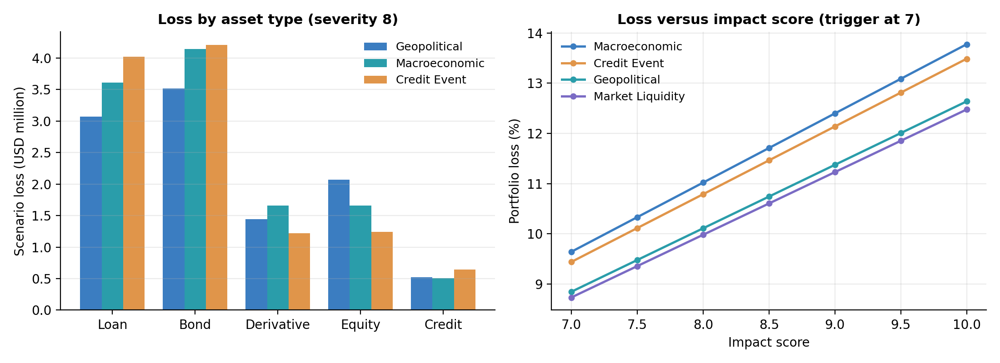

# RiskPulse - S&P Global & Crisil Campus Hackathon

| | |
|---|---|
| **Candidate Name** | Shusmit Sarkar |
| **College Email ID** | shusmit.sarkar@gmail.com |
| **College / Campus** | IIT Kharagpur |
| **Demo Video Link** | [YouTube unlisted link] |
| **Slide Deck** | [docs/presentation.pdf](docs/presentation.pdf) |
| **Written Report** | [docs/report.md](docs/report.md) |
| **Selected Module** | Module B - Strategic Portfolio Stress Testing |

## 1. Project Overview / Problem Statement & Approach

Risk teams must turn a constant flow of unstructured news into decisions: which events matter, what kind of events they are, and which exposures they touch. RiskPulse is a unified AI/NLP Risk Engine that ingests text from multiple public sources and outputs, for every article, a sentiment score in [-1, 1], an event class with confidence, matched entities, and a 1-10 impact score, all as structured JSON/CSV.

These signals drive **Module B**, an event-driven portfolio stress-testing tool. When an event's impact score is 7 or higher, the highest-impact article of each event class activates an event-specific scenario (equity, interest-rate, spread and PD shocks) that is applied to a mixed wholesale-banking portfolio of loans, bonds, derivatives, equities and credit exposures. Scores below 7 leave the portfolio unchanged.

The approach combines frozen pretrained language models (FinBERT, MiniLM) with transparent domain rules and a learned impact model (XGBoost on MiniLM embeddings, trained on a public news-to-price-move benchmark with a time-ordered holdout). Stress shocks are explicit and auditable, and the dashboard shows baseline vs. stressed value, scenario shocks, position-level losses and related news.

## Run it first

```powershell
.\.venv\Scripts\Activate.ps1
python -m pip install -r requirements.txt
python -m pip install -r requirements-models.txt
python -m uvicorn src.api.app:app --reload
```

In a second PowerShell terminal:

```powershell
cd web
npm install
npm run dev
```

Open the Vite URL printed in the terminal. The first model-backed run downloads the frozen inference weights and caches them locally. To use the optional conversational analyst or NewsAPI, copy `.env.example` to `.env` and add the relevant local key; never commit `.env`.

## Recorded presentation script

For the video submission, follow [docs/presentation_readme.md](docs/presentation_readme.md). It contains the exact timestamped screen actions and narration to show the complete Module B flow. [docs/demo_script.md](docs/demo_script.md) is the short index to that recording script.

## 2. Architecture & Tech Stack


**Data flow:** Google News RSS / GDELT DOC 2.0 / NewsAPI (optional) / CSV upload -> normalisation and URL deduplication -> NLP inference (sentiment, event class, entities, impact) -> structured signals -> Module B stress engine (with portfolio) -> FastAPI -> React dashboard and CSV export.

| Layer | Role |
|---|---|
| Ingestion | Fetch, clean and deduplicate articles from all sources |
| Risk inference | FinBERT sentiment, MiniLM class-description event classification, entity matching, XGBoost impact score |
| Impact training | Offline training and calibration of the impact model |
| Stress engine | Portfolio validation, event shocks, asset-level loss |
| Workflow and API | Orchestration and endpoints for analysis, stress testing, pipeline runs and portfolio retrieval |
| Dashboard | Signals, scenarios, charts, position drill-down, export |

**Tech stack:** Python, FastAPI, pandas, NumPy, scikit-learn, XGBoost, FinBERT and MiniLM (frozen transformer inference), React, Vite, Recharts, Papa Parse.

**Stress model:** for a triggered event with score `s`, shocks are scaled by `s/10`. Per position: `price_factor = 1 + beta * equity_shock - duration * rate_shock - spread_duration * spread_shock`, plus incremental credit loss `notional * (PD_stressed - PD) * LGD` for loans, bonds and credit exposures.

## 3. Dataset Used

- **Portfolio:** 12-position synthetic wholesale-banking portfolio (3 loans, 3 bonds, 2 derivatives, 3 equities, 1 credit pool; total value USD 105.12M) with value, notional, beta, duration, spread duration, PD and LGD.
- **Sample news:** generated financial-news records covering multiple event types, used to exercise the full pipeline.
- **News snapshot:** public Google News RSS headlines captured for reproducibility.
- **Entity lookup:** small public company and ticker list used for entity matching.
- **Impact model training data:** the public EDT news and market-price benchmark (downloaded by the training notebook, not bundled); 50,000 of 75,395 valid rows used.
- **Live sources:** Google News RSS and GDELT DOC 2.0 (NewsAPI optional).

All bundled datasets are in the `data` folder.

**Assumptions:** the portfolio is synthetic and not a real institution's book; shocks are illustrative scenario assumptions; the impact score is a market-movement proxy, not a causal loss forecast; ticker assignments in public benchmarks can be imperfect. A replacement portfolio CSV must contain `asset_id`, `asset_type`, `current_value`, `notional`, `equity_beta`, `duration`, `spread_duration`, `pd`, `lgd` (optional: `sector`, `counterparty`, `ticker`).

## 4. Quickstart & Installation

See **Run it first** in section 1 for the exact commands. Optional configuration: copy `.env.example` to `.env` for NewsAPI or the analyst assistant key; never commit `.env`.

Validation:

```powershell
.\.venv\Scripts\python.exe -m pytest -q
Push-Location web
npm run build
Pop-Location
```

## 5. Key Results & Domain Impact

- **Engine output:** every article gets `sentiment`, `sentiment_label`, `event_class`, `event_confidence`, `impact_score` and `triggered_stress`, via API or CSV export.
- **Impact model:** time-ordered holdout MAE 1.699 pp vs 1.731 pp for a median baseline (`models/training_report.json`).
- **Stress results at severity 8 on the USD 105.12M portfolio:**

| Event class | Stressed value (USD M) | Loss (USD M) | Loss % |
|---|---|---|---|
| Macroeconomic | 93.54 | 11.58 | 11.02 |
| Credit Event | 93.78 | 11.34 | 10.79 |
| Geopolitical | 94.49 | 10.63 | 10.11 |
| Market Liquidity | 94.63 | 10.49 | 9.98 |
| Regulatory/Legal | 97.39 | 7.73 | 7.35 |
| Operational/Cyber | 99.49 | 5.63 | 5.36 |
| Merger/Acquisition | 108.34 | -3.22 (gain) | -3.07 |



- **Domain impact:** analysts get a severity-ranked, classified signal list, see which loans, bonds, derivatives and equities are exposed and by how much, and can audit or recalibrate every shock and sensitivity. The JSON/CSV contract lets other downstream consumers plug into the same engine.

## License

MIT. See [LICENSE](LICENSE).
