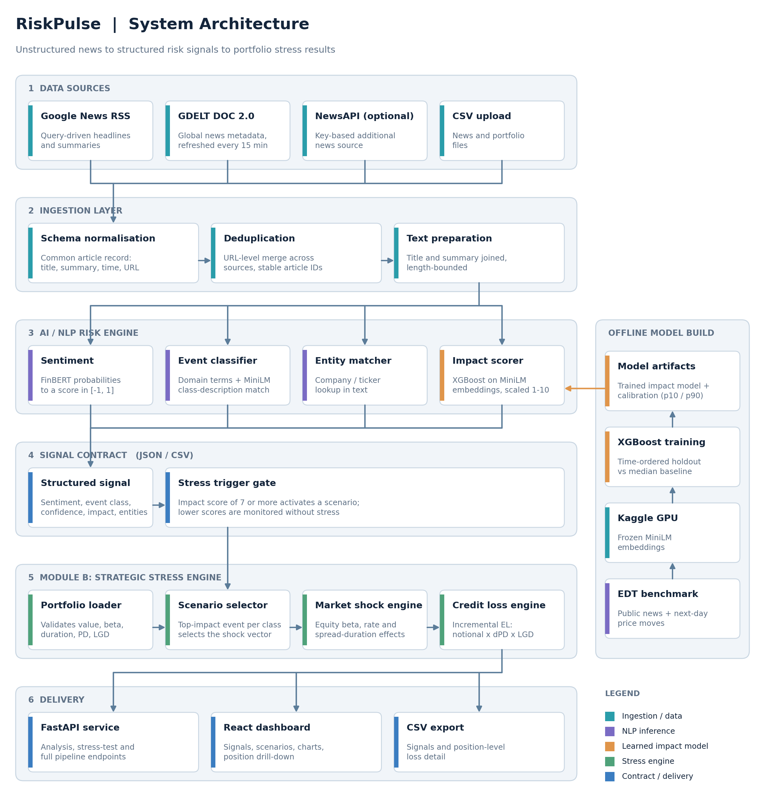

# iitkgp-shusmit-hackathon - S&P Global & Crisil Campus Hackathon

**Candidate Name:** Shusmit Sarkar

**College Email ID:** shusmit.sarkar@kgpian.iitkgp.ac.in

**College / Campus:** IIT Kharagpur

**Demo Video Link:** https://youtu.be/OYIBV7PF0Wk

**Slide Deck Link:** [docs/presentation.pdf](docs/presentation.pdf)

## 1. Project Overview / Problem Statement & Approach

Risk teams need to convert a continuous stream of unstructured financial news into structured, explainable risk intelligence. This project implements a unified AI/NLP Risk Engine that ingests public news from Google News RSS and GDELT, or bundled/uploaded CSV records, and produces a sentiment score, event classification, confidence, matched entities, and a 1-10 impact score for each article.

The selected downstream application is **Module B: Strategic Portfolio Stress Testing**. High-impact events activate event-specific equity, interest-rate, spread, and credit-loss shocks against a synthetic wholesale-banking portfolio. The dashboard shows the baseline and stressed portfolio values, scenario loss, shocks, position-level impact, and the news item that drove each scenario.

The implementation combines frozen pretrained FinBERT and MiniLM inference where available with deterministic lexical and domain-rule scoring. This keeps the complete workflow runnable when model downloads are unavailable. The impact model is an XGBoost model trained on a public news and market-price benchmark; all stress shocks are explicit, auditable scenario assumptions.

## 2. Architecture & Tech Stack

The system flow is:

`Google News RSS / GDELT / CSV upload -> normalization and deduplication -> NLP risk inference -> structured signals -> Module B stress engine -> FastAPI -> React/Vite dashboard`



- **Ingestion:** Google News RSS, GDELT DOC 2.0, optional NewsAPI, and CSV upload.
- **Risk inference:** FinBERT sentiment, MiniLM event descriptions, entity matching, lexical scoring, and XGBoost impact scoring.
- **Stress engine:** Portfolio schema validation, event-specific shocks, beta/duration/spread transmission, and PD/LGD credit-loss calculations.
- **API:** FastAPI and Uvicorn endpoints for health, portfolio retrieval, analysis, stress testing, and the complete pipeline.
- **Dashboard:** React, Vite, Recharts, Papa Parse, and Lucide icons.
- **Runtime dependencies:** Python 3.13, pandas, NumPy, scikit-learn, XGBoost, requests, FastAPI, and Uvicorn. Optional pretrained-model dependencies are listed in a separate requirements file.

## 3. Dataset Used

- **Portfolio:** a fully synthetic 12-position wholesale-banking portfolio containing loans, bonds, derivatives, equities, and credit exposure. It uses recognizable public-company names and tickers such as Apple, Alphabet, Oracle, Microsoft, Exxon Mobil, Chevron, JPMorgan Chase, and Bank of America only to keep the scenarios readable; the values and risk parameters are synthetic.
- **Sample news:** generated financial-news records covering multiple event classes, used for deterministic offline runs.
- **News snapshot:** a reproducible snapshot of publicly available news records.
- **Entity lookup:** a small public company and ticker list used for entity matching.
- **Live ingestion:** public Google News RSS and GDELT DOC 2.0 endpoints. NewsAPI is optional and requires a local key. Google News is searched once per holding and GDELT with combined holdings and market-wide queries, limited to the chosen lookback window. Every article is scored against the portfolio as a holding (title matches rank above summary-only matches), sector or market-wide match; ambiguous names such as Apple or Oracle need company context, and unrelated articles are dropped before analysis.
- **Impact-model training source:** a public news and market-price benchmark. The source is not proprietary, and the downloaded training data is not required to run the application.

All bundled datasets are in the `data` folder.

**Assumptions:** The portfolio, bundled sample records, and all company exposures are synthetic. No S&P Global, Crisil, client, confidential, or proprietary data is used. A score of 7 or higher triggers a stress scenario. Shocks are analyst-defined scenario assumptions, not forecasts or causal loss estimates. Public-news feeds can return partial coverage or no matching articles, while the bundled sample mode gives a deterministic run.

## 4. Quickstart & Installation

Runtime: **Python 3.13.14 on Windows 11 using PowerShell**. Node.js 20+ and npm are required for the dashboard.

From a fresh clone:

```powershell
git clone https://github.com/SHUSMIT/iitkgp_shusmit_hackathon.git
cd iitkgp_shusmit_hackathon
py -3.13 -m venv .venv
.\.venv\Scripts\Activate.ps1
python -m pip install -r requirements.txt
python -m pip install -r requirements-models.txt
Push-Location web
npm install
Pop-Location
.\scripts\run.ps1
```

The final command is the exact application entry point from the repository root. It starts the FastAPI API, waits for `/health`, starts the React/Vite dashboard, and opens `http://127.0.0.1:5173`. The API is available at `http://127.0.0.1:8000`. Press `Ctrl+C` to stop both services.

For a deterministic offline run, select **Sample portfolio news** in the dashboard. The first model-backed run may download and cache pretrained weights; if optional model initialization is unavailable, the deterministic lexical scoring still produces complete signals and stress scenarios.

## 5. Key Results & Domain Impact

- The engine returns structured sentiment, event class, event confidence, matched entity, impact score, and stress-trigger status for every analyzed article.
- News retrieval is portfolio-driven: queries come from the holdings, each signal shows the holdings it is linked to, and each stress scenario is driven by the most relevant article for its event class.
- Module B reports baseline value, stressed value, absolute loss or gain, loss percentage, scenario shocks, and position-level asset impact.
- The synthetic portfolio contains 12 positions across five asset types and shows transmission through equity beta, interest-rate duration, credit spread duration, PD, and LGD.
- The dashboard supports sample, live-feed, and uploaded-news workflows, portfolio CSV upload, signal export, scenario selection, position drill-down, and an analyst query panel.
- The result is useful to risk analysts because it turns unstructured public information into severity-ranked events and shows how an event-specific scenario affects named exposures.

The written report with the system design, results and assumptions is available at [docs/report.pdf](docs/report.pdf).
